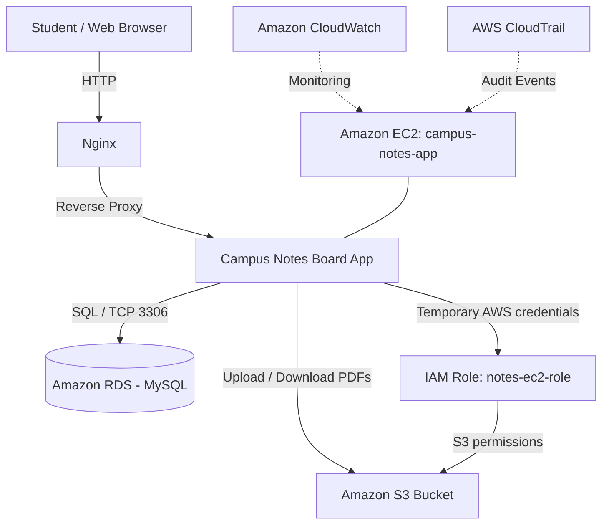

# Campus Notes Board

## 1. Overview and architecture diagram

Campus Notes Board is a web application that allows students to upload, view, and download course-related PDF notes. The application runs on an Amazon EC2 instance, uses Amazon RDS (MySQL) to store note information and metadata, and uses Amazon S3 to store the uploaded PDF files. An IAM role grants the EC2 instance permission to access S3 without storing AWS access keys on the server.

### Architecture



### Main AWS resources

| Resource | Name / purpose |
|---|---|
| Region | `eu-north-1` (Europe – Stockholm) |
| VPC | `campus-notes-vpc` |
| Internet Gateway | `campus-notes-igw` |
| EC2 instance | `campus-notes-app` |
| EC2 security group | `app-sg` |
| RDS database | `campus-notes-db` |
| RDS security group | `db-sg` |
| IAM role | `notes-ec2-role` |
| S3 bucket | `YOUR_BUCKET_NAME` |
| Database | `campus_notes` |

Architecture diagram image: `screenshots/architecture.png` (add this file if you export your diagram as an image).

## 2. Prerequisites

To reproduce this deployment, you need:

- An AWS account or an authorized AWS Skill Builder project environment.
- Access to the AWS Management Console.
- AWS Region: `eu-north-1` (Europe – Stockholm).
- An IAM identity with permission to create and manage the required VPC, EC2, RDS, S3, IAM, CloudWatch, and CloudTrail resources.
- An Ubuntu EC2 instance.
- Session Manager access to the EC2 instance, or another authorized administrative connection method.
- A terminal with SSH/client tools where required.
- Git and a GitHub account for storing the project source code and documentation.
- MySQL client for testing database connectivity.
- A PDF file for testing uploads and downloads.

**Important:** Use an IAM identity with only the permissions required for the deployment. Do not use root credentials for routine work.

## 3. Deployment steps

The following describes the deployment sequence. Replace example values and commands with the exact values used in your working environment.

### Step 1: Create the network infrastructure

1. Create the VPC named `campus-notes-vpc`.
2. Create the public and private subnets.
3. Attach the Internet Gateway named `campus-notes-igw`.
4. Configure the public route table to route internet-bound traffic through the Internet Gateway.
5. Keep the private route table without a direct Internet Gateway route.
6. Associate the route tables with their intended subnets.
7. Create the security groups `app-sg` and `db-sg`.

See [`docs/network.md`](docs/network.md) for the network design and subnet details.

### Step 2: Launch the EC2 instance

Launch the Ubuntu EC2 instance named `campus-notes-app`.

- Select the intended VPC and public subnet.
- Attach the `app-sg` security group.
- Attach the IAM instance role `notes-ec2-role`.
- Enable the access method used for administration, such as AWS Systems Manager Session Manager.
- Confirm that the instance is running and can be reached through the selected access method.

### Step 3: Prepare the EC2 environment

Connect to the instance through Session Manager.

Update the package index and install the software required by the application. For an Ubuntu instance, the general commands are:

```bash
sudo apt update
sudo apt upgrade -y
```

Install the dependencies required by the application, including the appropriate runtime, MySQL client, Git, and Nginx.

```bash
sudo apt install -y git nginx mysql-client
```

Install any additional application-specific dependencies according to the starter project's instructions.

### Step 4: Deploy the application

Clone the project repository:

```bash
git clone YOUR_GITHUB_REPOSITORY_URL
cd campus-notes-board
```

Install the application's dependencies using the package manager specified by the project.

Configure the application environment variables before starting the service.

### Step 5: Configure the application service

Create a dedicated Linux service user for the application rather than running it as root.

Create and configure a systemd service named `notes` using the application's actual startup command and working directory.

After creating the service:

```bash
sudo systemctl daemon-reload
sudo systemctl enable notes
sudo systemctl start notes
sudo systemctl status notes --no-pager
```

Check application logs:

```bash
sudo journalctl -u notes -n 100 --no-pager
```

### Step 6: Configure Nginx

Configure Nginx as a reverse proxy so that incoming HTTP requests are forwarded to the application process running locally on the EC2 instance.

Test the Nginx configuration:

```bash
sudo nginx -t
```

Restart Nginx:

```bash
sudo systemctl restart nginx
sudo systemctl enable nginx
```

### Step 7: Verify the deployment

Check the application's health endpoint:

```bash
curl http://localhost/health
```

The application should report the status of its application process, database connection, and S3 access.

Open the EC2 instance's public address in a browser to test the application.

## 4. Configuration variables

The following variables are used to configure the application. Actual values and secrets are not stored in this README.

| Variable | Meaning |
|---|---|
| `DB_HOST` | RDS endpoint |
| `DB_PORT` | Database port |
| `DB_NAME` | Database name |
| `DB_USER` | Application database user |
| `DB_PASSWORD` | Password for the application database user |
| `S3_BUCKET` | Bucket used to store PDF files |
| `AWS_REGION` | AWS Region of the S3 bucket |
| `MAX_UPLOAD_MB` | Maximum accepted PDF upload size (optional) |

### Environment file

The environment file should be stored outside the Git repository and should not be publicly accessible.

Example recommended location:

```text
/etc/notes/notes.env
```

The file should be owned by the appropriate administrative account and readable only by root and the application service account.

Example permissions:

```bash
sudo chown root:notes /etc/notes/notes.env
sudo chmod 640 /etc/notes/notes.env
```

These commands assume that the application service user is named `notes`. Adjust the owner and group to match the actual user configured on your EC2 instance.

Never commit the environment file, database password, AWS credentials, or other secrets to GitHub.

## 5. Database and S3 setup

### Amazon RDS – MySQL

The project uses Amazon RDS with MySQL to store information about uploaded notes.

Database configuration:

| Setting | Value |
|---|---|
| DB instance identifier | `campus-notes-db` |
| Engine | MySQL |
| Port | `3306` |
| Database name | `campus_notes` |
| Application database user | `notes_app` |

The application database user should have only the privileges required to work with the application's database and tables.

The `notes` table stores information about uploaded files, including:

- `id`
- `title`
- `course_name`
- `description`
- `s3_object_key`
- `created_at`

The PDF files themselves are stored in S3. The database stores their metadata and the corresponding S3 object keys.

### Amazon S3

The project uses an S3 bucket to store uploaded PDF documents.

The bucket should have the following security settings:

- Block Public Access enabled.
- Object Ownership set to Bucket owner enforced, if this is the setting used in the deployment.
- Server-side encryption enabled using SSE-S3.
- No public bucket policy or public object permissions.
- PDF objects stored under the `notes/` prefix.

The application accesses the bucket through the EC2 instance's IAM role rather than through hardcoded AWS access keys.

## 6. Security

### Security groups

**`app-sg` – Application security group**

Controls traffic reaching the EC2 application instance.

Document the actual inbound rules configured in your AWS console. The intended setup allows web traffic from the appropriate client network and permits the administration method used for the instance.

**`db-sg` – Database security group**

Controls access to the RDS database.

The intended MySQL inbound rule is:

| Type | Protocol | Port | Source |
|---|---|---|---|
| MySQL/Aurora | TCP | `3306` | `app-sg` |

The database should not accept direct public internet connections. Only the application instance should be allowed to connect through the configured security-group relationship.

### IAM instance role

The EC2 instance uses the IAM role:

`notes-ec2-role`

The role allows the application to obtain temporary AWS credentials through the EC2 instance metadata service.

This avoids storing permanent AWS access keys on the EC2 instance.

The role should include:

- `AmazonSSMManagedInstanceCore` for Systems Manager access, if Session Manager is used.
- A project-specific S3 policy granting only the permissions required by the application.

### S3 permissions

The application-specific policy should contain the following permissions:

| Action | Resource | Purpose |
|---|---|---|
| `s3:ListBucket` | Bucket ARN | List objects in the bucket, if required by the application |
| `s3:PutObject` | `bucket/notes/*` | Upload PDF files |
| `s3:GetObject` | `bucket/notes/*` | Download PDF files |

The resource ARN must use the actual bucket name.

These permissions follow the principle of least privilege: the application receives access only to the S3 resources and operations it needs.

## 7. Evidence

The following screenshots should be included in the repository to demonstrate the deployment and testing process.

| Evidence | Screenshot |
|---|---|
| AWS architecture diagram | `screenshots/architecture.png` |
| VPC and subnet configuration | `screenshots/vpc-subnets.png` |
| Route table configuration | `screenshots/route-tables.png` |
| EC2 instance running | `screenshots/ec2-running.png` |
| RDS configuration | `screenshots/rds-configuration.png` |
| S3 bucket security settings | `screenshots/s3-security.png` |
| IAM role and policy | `screenshots/iam-role-policy.png` |
| Successful application health check | `screenshots/health-check.png` |
| Successful PDF upload | `screenshots/pdf-upload.png` |
| Database record after upload | `screenshots/database-record.png` |
| PDF object in S3 | `screenshots/s3-object.png` |
| Successful PDF download | `screenshots/pdf-download.png` |
| Direct S3 URL returning HTTP 403 | `screenshots/s3-private-access.png` |
| CloudWatch alarm triggered | `screenshots/cloudwatch-alarm.png` |
| CloudTrail management event | `screenshots/cloudtrail-event.png` |
| Troubleshooting and recovery | `screenshots/troubleshooting.png` |

Only include screenshots of tests and configurations that you have actually completed.

## 8. Known limitations, cost and cleanup

### Known limitations

Document the limitations that apply to the deployed application. Review the starter project's `app/README.md` and retain the relevant limitations.

Possible areas to discuss, if they apply to your implementation:

- The application is intended for a limited student/project environment rather than large-scale production traffic.
- The application accepts PDF documents rather than arbitrary file types.
- The application depends on the availability of its EC2 instance, RDS database, and S3 bucket.
- The deployment uses HTTP unless HTTPS has been separately configured.
- Authentication and authorization features should be documented according to what the application actually implements.

### Cost considerations

The project uses AWS resources that may incur charges, including:

- EC2 instance runtime.
- Amazon RDS instance runtime and storage.
- Amazon S3 storage and requests.
- Data transfer.
- CloudWatch monitoring and logs, where applicable.

The project environment provided a $100 credit allowance. This is a credit allocation, not proof that the deployment cost nothing.

| Cost item | Estimated monthly cost | Actual cost |
|---|---:|---:|
| Amazon EC2 | To be calculated | To be verified |
| Amazon RDS | To be calculated | To be verified |
| Amazon S3 | To be calculated | To be verified |
| CloudWatch and other services | To be calculated | To be verified |
| **Total** | **To be calculated** | **To be verified** |

Use AWS Pricing Calculator for the estimate and the available billing or project-credit dashboard to verify actual charges. Do not report an estimated amount as actual spending.

### Cleanup

After completing the project demonstration and saving all required evidence:

1. Stop or terminate the EC2 instance when it is no longer required.
2. Delete the RDS database after confirming that its data is no longer needed.
3. Empty the S3 bucket before deleting it.
4. Delete unused security groups, route tables, subnets, and the VPC after checking their dependencies.
5. Detach and delete unused IAM policies and roles.
6. Remove unused CloudWatch alarms and log groups.
7. Confirm that no billable resources remain active.

**Important:** Do not delete resources before the assessment or demonstration if you still need them. Save screenshots and documentation before cleanup.

---

## Project repository

GitHub: `YOUR_GITHUB_REPOSITORY_URL`

